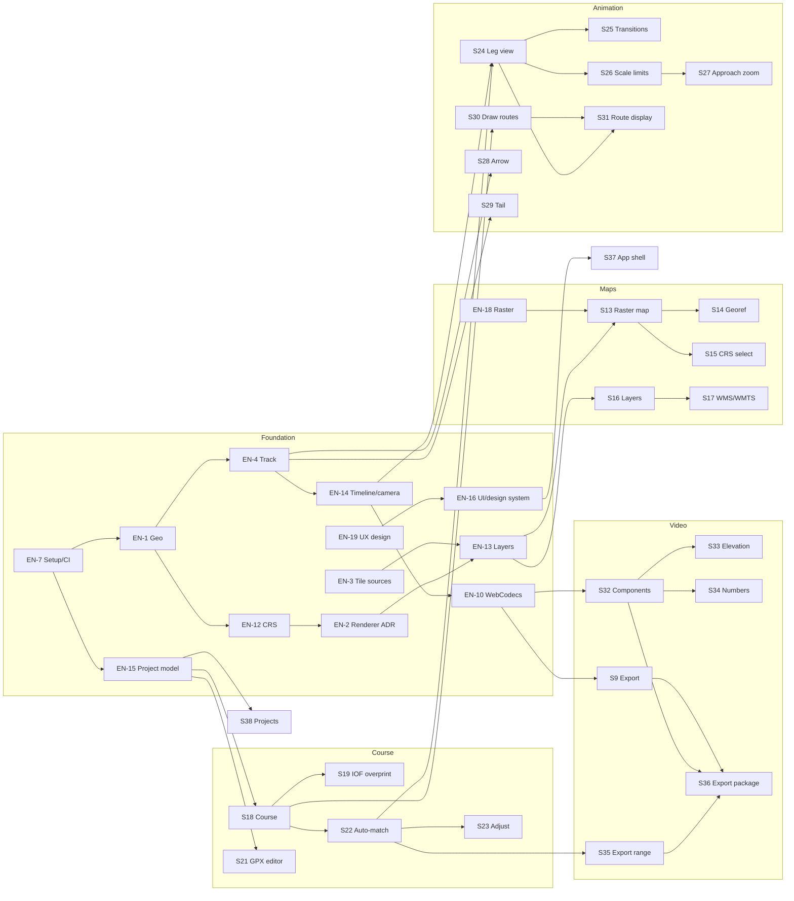

# Orienteering Map Video – Implementation Plan

## Product vision

A browser-only application that produces **animated orienteering map videos for head cam footage**.
The user adds their orienteering map, sets the course, loads the GPX of their run and gets a frame-exact map animation:
oriented leg by leg, with the route choices, a navigation arrow and a pace-coloured tail. Separate data videos
(elevation profile, pace, heart rate, time, distance) are exported alongside it, frame-exactly in sync with each other.
The user combines them with the head cam footage in a video editor (DaVinci Resolve). The files are standard opaque
videos with no dependency on any editor.

The backlog started from the working POC (`web-omap-poc`). Acceptance criteria marked _(POC)_ describe behaviour the POC
already has. Items marked **Change:** are where the POC behaviour must change for the new requirements.
Everything under **Open questions / refinement** is still to be decided.

## Issue types and priorities

| Type        | Purpose                                                                                                |
| ----------- | ------------------------------------------------------------------------------------------------------ |
| **Epic**    | Overall business goal and scope                                                                        |
| **Story**   | User-visible functionality, written from the user's point of view                                      |
| **Enabler** | Technical groundwork (architecture, infrastructure, spikes, design, compliance) that stories depend on |

**Priority** (MoSCoW) is relative to the first public release (R2 below): _Must_, _Should_, _Could_.

## Glossary

| Term                         | Meaning                                                                                                                                      |
| ---------------------------- | -------------------------------------------------------------------------------------------------------------------------------------------- |
| **Free mode**                | Animation without a course: the map follows the runner, heading-up.                                                                          |
| **Course mode**              | Animation with a course: leg-oriented views, transitions, route choices ([EPIC-4](./EPIC-4-course-animation.md)).                            |
| **Leg**                      | Start → control 1, control _n_ → _n+1_, last control → finish.                                                                               |
| **Passing time**             | The moment the track is at a control (matched automatically or set by hand).                                                                 |
| **View CRS**                 | The planar coordinate system the map is drawn in: TM35FIN, UTM or Web Mercator ([EN-12](./enablers/EN-12-coordinate-reference-systems.md)).  |
| **Track time / video time**  | Seconds in the GPX vs. seconds in the exported video; equal at 1×. User-facing animation durations are in video time.                        |
| **Zoom-in / zoom-out limit** | The largest scale (e.g. 1:4 000) and smallest scale (e.g. 1:15 000) the camera may use. Used instead of "max/min scale", which is ambiguous. |
| **Pace**                     | min/km. The requirement text says "phase"; confirmed to mean pace.                                                                           |

## Backlog index

### Epics

| ID                                          | Title                                                       |
| ------------------------------------------- | ----------------------------------------------------------- |
| [EPIC-1](./EPIC-1-gpx-replay.md)            | GPX replay and video export (POC baseline)                  |
| [EPIC-2](./EPIC-2-maps-and-coordinates.md)  | Orienteering maps, background layers and coordinate systems |
| [EPIC-3](./EPIC-3-course-and-gpx.md)        | Orienteering course and GPX alignment                       |
| [EPIC-4](./EPIC-4-course-animation.md)      | Course-aware map animation                                  |
| [EPIC-5](./EPIC-5-data-component-videos.md) | Data component videos                                       |
| [EPIC-6](./EPIC-6-ux-and-project.md)        | Modern, usable UI and project workflow                      |

### Stories

| ID                                                                | Epic | Title                                                                     | Prio   | Depends on                   |
| ----------------------------------------------------------------- | ---- | ------------------------------------------------------------------------- | ------ | ---------------------------- |
| [STORY-1](./stories/STORY-1-resizable-map-window.md)              | 1    | Video frame size with aspect presets                                      | Must   | EN-2, EN-16                  |
| [STORY-2](./stories/STORY-2-load-gpx.md)                          | 1    | Load a GPX track                                                          | Must   | EN-4                         |
| [STORY-3](./stories/STORY-3-playback-controls.md)                 | 1    | Preview playback with speed and timeline controls                         | Must   | STORY-2, EN-14               |
| [STORY-4](./stories/STORY-4-follow-position.md)                   | 1    | Free mode – map follows the GPX position                                  | Must   | STORY-3, EN-14               |
| [STORY-5](./stories/STORY-5-heading-up-rotation.md)               | 1    | Free mode – heading-up rotation                                           | Must   | STORY-4, EN-4                |
| [STORY-6](./stories/STORY-6-playback-scale.md)                    | 1    | Set map scale                                                             | Must   | STORY-4, EN-12               |
| [STORY-7](./stories/STORY-7-free-map-navigation.md)               | 1    | Pan, zoom and rotate the map when not playing                             | Must   | EN-2                         |
| [STORY-8](./stories/STORY-8-map-overlays.md)                      | 1    | Map overlays incl. leg indicator                                          | Must   | EN-2                         |
| [STORY-9](./stories/STORY-9-record-video.md)                      | 1    | Export the map animation as a video                                       | Must   | EN-10, EN-6, EN-14           |
| [STORY-10](./stories/STORY-10-video-quality.md)                   | 1    | Video format, quality and bitrate                                         | Should | STORY-9                      |
| [STORY-11](./stories/STORY-11-save-video.md)                      | 1    | Save exported videos to disk                                              | Must   | STORY-9                      |
| [STORY-12](./stories/STORY-12-technical-info.md)                  | 1    | Browser capability info                                                   | Should | EN-9                         |
| [STORY-13](./stories/STORY-13-add-raster-map.md)                  | 2    | Add an orienteering raster map                                            | Must   | EN-12, EN-13, EN-18          |
| [STORY-14](./stories/STORY-14-georeference-raster-manually.md)    | 2    | Georeference a raster map manually                                        | Must   | STORY-13, STORY-16           |
| [STORY-15](./stories/STORY-15-view-crs-selection.md)              | 2    | Automatic coordinate system selection                                     | Must   | EN-12, EN-13                 |
| [STORY-16](./stories/STORY-16-background-layers.md)               | 2    | Default background map (MapAnt) and layer panel                           | Must   | EN-3, EN-13                  |
| [STORY-17](./stories/STORY-17-custom-wms-wmts.md)                 | 2    | Add a custom WMS / WMTS layer                                             | Should | STORY-16                     |
| [STORY-18](./stories/STORY-18-set-course.md)                      | 3    | Set an orienteering course                                                | Must   | EN-15, EN-16                 |
| [STORY-19](./stories/STORY-19-iof-course-overprint.md)            | 3    | Course in IOF overprint style, show/hide                                  | Must   | STORY-18                     |
| [STORY-20](./stories/STORY-20-import-course.md)                   | 3    | Import a course from IOF XML                                              | Could  | STORY-18                     |
| [STORY-21](./stories/STORY-21-gpx-editor.md)                      | 3    | Edit the GPX track to fix GPS errors                                      | Must   | STORY-2, EN-15               |
| [STORY-22](./stories/STORY-22-auto-match-gpx-to-course.md)        | 3    | Match the GPX to the course automatically                                 | Must   | STORY-18, STORY-2            |
| [STORY-23](./stories/STORY-23-adjust-control-times.md)            | 3    | Adjust control passing times manually                                     | Must   | STORY-22                     |
| [STORY-24](./stories/STORY-24-leg-oriented-view.md)               | 4    | Leg-oriented map view                                                     | Must   | STORY-22, EN-14              |
| [STORY-25](./stories/STORY-25-leg-transitions.md)                 | 4    | Smooth transitions between legs                                           | Must   | STORY-24                     |
| [STORY-26](./stories/STORY-26-scale-limits-and-panning.md)        | 4    | Scale limits and panning                                                  | Must   | STORY-24                     |
| [STORY-27](./stories/STORY-27-approach-zoom.md)                   | 4    | Zoom in when approaching the control                                      | Should | STORY-26                     |
| [STORY-28](./stories/STORY-28-navigation-arrow.md)                | 4    | Position as a navigation arrow                                            | Must   | EN-4                         |
| [STORY-29](./stories/STORY-29-gpx-tail.md)                        | 4    | GPX tail with length and pace colours                                     | Must   | EN-4                         |
| [STORY-30](./stories/STORY-30-draw-route-choices.md)              | 4    | Draw route choices for each leg                                           | Must   | STORY-18                     |
| [STORY-31](./stories/STORY-31-route-choice-display.md)            | 4    | Show route choices during the leg (timing, fade, lengths)                 | Must   | STORY-30, STORY-24           |
| [STORY-32](./stories/STORY-32-data-component-videos.md)           | 5    | Data component videos, synchronised                                       | Must   | EN-14, EN-10                 |
| [STORY-33](./stories/STORY-33-elevation-profile.md)               | 5    | Elevation profile component                                               | Must   | STORY-32                     |
| [STORY-34](./stories/STORY-34-numeric-components.md)              | 5    | Pace, heart rate, elapsed time, elapsed distance                          | Must   | STORY-32                     |
| [STORY-35](./stories/STORY-35-export-time-range.md)               | 5    | Set the export time range                                                 | Must   | EN-14, STORY-22              |
| [STORY-36](./stories/STORY-36-export-package.md)                  | 5    | Export the map and component videos together                              | Must   | STORY-9, STORY-32, STORY-35  |
| [STORY-37](./stories/STORY-37-app-shell-and-workflow.md)          | 6    | Modern app shell with a guided workflow                                   | Must   | EN-16, EN-19                 |
| [STORY-38](./stories/STORY-38-save-open-project.md)               | 6    | Save and open projects                                                    | Must   | EN-15                        |
| [STORY-39](./stories/STORY-39-animation-settings-and-presets.md)  | 6    | Animation and style settings with presets                                 | Must   | EN-15, STORY-37              |
| [STORY-40](./stories/STORY-40-localisation-and-units.md)          | 6    | Localisation (FI/EN) and number formats                                   | Could  | EN-16                        |
| [STORY-41](./stories/STORY-41-import-results-split-comparison.md) | 5    | Import results (IOF XML 2.0/3.0): leg sync and split comparison component | Should | STORY-22, STORY-23, STORY-32 |
| [STORY-42](./stories/STORY-42-progressive-leg-zoom.md)            | 4    | Progressive leg zoom towards the target                                   | Should | STORY-24, STORY-26, STORY-27 |
| [STORY-43](./stories/STORY-43-responsive-arrow-heading.md)        | 4    | Responsive arrow heading                                       |           Should | EN-4, STORY-28               |
| [STORY-44](./stories/STORY-44-circle-position-marker.md)          | 4    | Circle as an alternative position marker                       |           Could  | STORY-28, STORY-39           |
| [STORY-45](./stories/STORY-45-instant-leg-change.md)              | 4    | Instant leg change, no transition animation                    |           Should | STORY-25                     |
| [STORY-46](./stories/STORY-46-real-time-transition-clips.md)      | 5    | Leg transitions as separate real-time clips                    |           Could  | STORY-25, STORY-36, STORY-45 |
| [STORY-47](./stories/STORY-47-global-time-base.md)                | 6    | One global time base for all durations                         |           Should | STORY-31, STORY-39           |

### Enablers

| ID                                                         | Epic | Title                                                          | Prio   |
| ---------------------------------------------------------- | ---- | -------------------------------------------------------------- | ------ |
| [EN-1](./enablers/EN-1-geo-math.md)                        | 1    | Geo math library (geodesy, bearing, scale ↔ resolution)        | Must   |
| [EN-2](./enablers/EN-2-canvas-map-renderer.md)             | 1    | Map rendering engine on OpenLayers (performance gate)          | Must   |
| [EN-3](./enablers/EN-3-tile-source-and-cache.md)           | 2    | Map tile sources (MapAnt default), licensing, tile cache       | Must   |
| [EN-4](./enablers/EN-4-track-model-and-heading.md)         | 1    | Track model, heading and derived metrics (HR, pace, elevation) | Must   |
| [EN-5](./enablers/EN-5-recording-pipeline.md)              | 1    | Real-time MediaRecorder pipeline (fallback)                    | Should |
| [EN-6](./enablers/EN-6-tile-prefetch.md)                   | 1    | Tile prefetch along the camera path                            | Must   |
| [EN-7](./enablers/EN-7-project-setup-ci.md)                | 1    | Project setup, build and CI                                    | Must   |
| [EN-8](./enablers/EN-8-test-strategy.md)                   | 1    | Test strategy and hermetic E2E tests                           | Must   |
| [EN-9](./enablers/EN-9-browser-compatibility.md)           | 1    | Browser compatibility matrix                                   | Should |
| [EN-10](./enablers/EN-10-spike-offline-rendering.md)       | 1    | Spike: frame-exact WebCodecs export                            | Must   |
| [EN-11](./enablers/EN-11-spike-orienteering-maps.md)       | 2    | Spike: OMAP/OCD vector maps                                    | Could  |
| [EN-12](./enablers/EN-12-coordinate-reference-systems.md)  | 2    | Coordinate reference systems and view CRS                      | Must   |
| [EN-13](./enablers/EN-13-layer-model-and-reprojection.md)  | 2    | Layer model, WMS/WMTS, reprojection (on OpenLayers)            | Must   |
| [EN-14](./enablers/EN-14-animation-timeline-camera.md)     | 4    | Deterministic animation timeline and camera director           | Must   |
| [EN-15](./enablers/EN-15-project-model-and-persistence.md) | 6    | Project model, undo/redo, persistence                          | Must   |
| [EN-16](./enablers/EN-16-ui-framework-design-system.md)    | 6    | Svelte 5, design system, app shell                             | Must   |
| [EN-18](./enablers/EN-18-large-raster-handling.md)         | 2    | Large raster image handling                                    | Must   |
| [EN-19](./enablers/EN-19-ux-research-and-design.md)        | 6    | UX research, interaction and visual design                     | Must   |

## Dependency overview (key paths)

## Suggested release plan

| Release                              | Goal                                                          | Content                                                                                                                |
| ------------------------------------ | ------------------------------------------------------------- | ---------------------------------------------------------------------------------------------------------------------- |
| **R0 – Foundation**                  | Decisions made, architecture in place                         | EN-7, EN-8, EN-19 (starts at once), EN-1, EN-12, **EN-2 ADR**, EN-3, EN-13, EN-4, EN-14, **EN-10 spike**, EN-15, EN-16 |
| **R1 – Course map video (internal)** | First end-to-end course-mode video on a real orienteering map | STORY-2, 3, 1, 6, 7, 8, 13, 15, 16, 18, 19, 22, 23, 24, 25, 26, 28, 29, 9, 11, 37, 38, EN-6, EN-18                     |
| **R2 – Public release**              | All requirements in this backlog's Must scope                 | STORY-14, 21, 30, 31, 27, 32, 33, 34, 35, 36, 39, 10, 17, EN-9, STORY-12, STORY-4/5 (free mode polish)                 |
| **R3 – Extensions**                  | Nice-to-haves                                                 | STORY-20, 40, 41, EN-11, EN-5 (fallback only if needed), FIT import, DEM elevation                                     |

The EN-10 export spike and the EN-2 OpenLayers performance gate should be done **first**. Their results can change the scope and size of
many stories.

## Decisions (product owner, Nov 2026)

| #   | Topic                        | Decision                                                                                                                                                            | Affects               |
| --- | ---------------------------- | ------------------------------------------------------------------------------------------------------------------------------------------------------------------- | --------------------- |
| 1   | "Phase" in the requirements  | Means **pace (min/km)**                                                                                                                                             | STORY-29, STORY-34    |
| 2   | Head cam sync                | **Out of scope.** Syncing is done in the video editor. The app only sets the export range                                                                           | STORY-35, EPIC-5      |
| 3   | Transparent video            | **Not used.** All outputs are opaque, standard files with no dependency on any editor. DaVinci Resolve is the main editor to test with. EN-17 (alpha spike) removed | STORY-10, 32, 36      |
| 4   | Background map               | **MapAnt** WMTS by default (TM35 and Web Mercator services)                                                                                                         | EN-3, EN-13, STORY-16 |
| 5   | Rendering                    | **OpenLayers**, accepted after a performance gate; custom WebGL is the fallback                                                                                     | EN-2, EN-13           |
| 6   | UI framework                 | **Svelte 5**                                                                                                                                                        | EN-16, EN-7           |
| 8   | Coordinate system in Finland | **Finnish projects always use TM35FIN**, with or without a raster map                                                                                               | EN-12, STORY-15       |
| 9   | Map frame content            | **Map, route and runner only** (+ optional north arrow). No info box, scale bar or attribution in the video; credits shown in the app for the video description     | STORY-8, EN-3         |
| 10  | Frame size                   | **Freely resizable** frame plus aspect presets                                                                                                                      | STORY-1               |
| 7   | Platform                     | **Desktop first**; tablet usable, phones view-only                                                                                                                  | EN-16, STORY-37       |

### Still open

- Global fallback map provider for areas outside MapAnt coverage, and budget ([EN-3](./enablers/EN-3-tile-source-and-cache.md)).
- Should MapAnt be told about the expected export traffic before the public release?

## Issue template

Every issue file uses the same sections: _Summary / user story_, _Acceptance criteria_, _POC reference_ (if any),
_Technical notes_, _Open questions / refinement_, _Dependencies_, _Estimate_ (left as TBD for refinement).
Header line: **Type · Epic · Priority · Labels** (and **Status** where an issue is only proposed).
